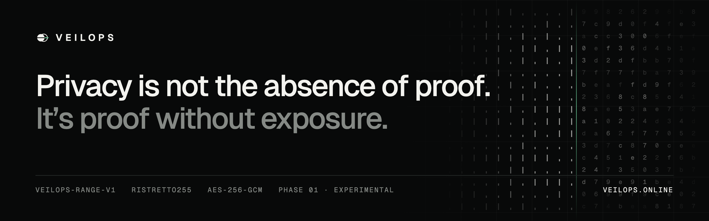
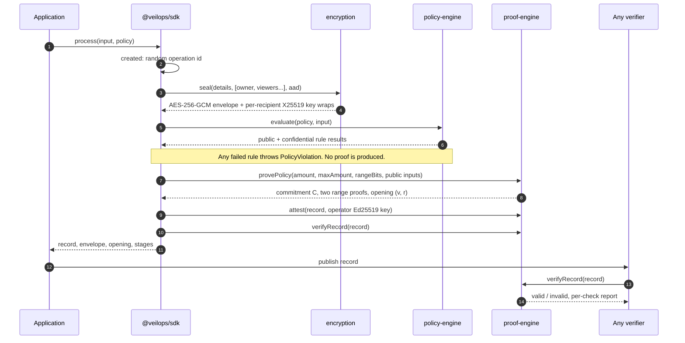

<p align="center"><a href="https://veilops.tech"></a></p>

<p align="center">
  <a href="https://github.com/veilops-protocol/veilops/actions/workflows/ci.yml"></a>
  <a href="https://github.com/veilops-protocol/veilops/actions/workflows/codeql.yml"></a>
  <a href="https://github.com/veilops-protocol/veilops/actions/workflows/devnet-anchors.yml"></a>
  <a href="LICENSE"></a>
  
  <a href="https://veilops.tech"></a>
</p>

# VEILOPS

> Privacy is not the absence of proof. It's proof without exposure.

Privacy infrastructure for programmable financial operations, cryptographic proofs and selective disclosure.

[veilops.tech](https://veilops.tech) · [Verify it yourself](VERIFY.md) · [Documentation](docs/) · [Security](SECURITY.md) · [Contributing](CONTRIBUTING.md) · License: [Apache-2.0](LICENSE)

> **Status: experimental, Phase 01 (Foundation).** The cryptography in this repository is real but has not been audited or externally reviewed. There are no npm packages and no mainnet deployment; an experimental on-chain verifier runs on Solana devnet. Releases ship reproducible package tarballs with signed build provenance, not production builds. Do not use it to protect real funds or real personal data.

## Verify, don't trust

| Check | Where |
| --- | --- |
| Reproducible build: byte-identical package tarballs + `SHA256SUMS` | `bash scripts/reproduce.sh`, [VERIFY.md §1](VERIFY.md#1-reproducible-build) |
| Reference test vectors, checked by a second, independent standard-library Python implementation | [`test-vectors/`](test-vectors), [`verifiers/python/`](verifiers/python) |
| Zero-knowledge proofs verified **on-chain** by a Solana program on devnet (3 verified, 2 forgeries rejected); deployed binary matches the reproducible build | [VERIFY.md §3a](VERIFY.md#3a-on-chain-proof-verification-devnet), [onchain/](onchain) |
| Records anchored on Solana devnet, re-checked daily from a public RPC | [VERIFY.md §3](VERIFY.md#3-solana-devnet-anchors) |
| Signed build provenance on release assets | `gh attestation verify`, [VERIFY.md §4](VERIFY.md#4-build-provenance) |
| SSH-signed commits from a published maintainer key | [MAINTAINERS.md](MAINTAINERS.md) |
| Independent cryptographic review | **Not yet.** Scope and status: [docs/audit-scope.md](docs/audit-scope.md) |

---

## What is VEILOPS?

VEILOPS is a TypeScript toolkit for publishing **verifiable records of financial operations without publishing their sensitive values**. An operator (a DAO treasury, a payroll run, a vendor payment) processes an operation locally and gets back:

- a **public record** that anyone can verify: it contains a Pedersen commitment to the amount, a zero-knowledge range proof that the amount satisfies the policy limit, and an Ed25519 signature by the operator;
- an **encrypted envelope** (AES-256-GCM) containing the plaintext details, readable only by the owner and explicitly authorized viewers such as an auditor;
- a **commitment opening** that the operator can hand to a specific party to disclose the exact amount on demand.

A verifier learns that the amount is between `0` and the published policy limit. They do not learn the amount.

## Why it exists

Public ledgers make every operation auditable by everyone, which is the right default for settlement and the wrong default for payroll, vendor contracts and treasury strategy. The usual alternatives are to publish everything, or to publish nothing and ask people to trust an off-chain report.

VEILOPS takes a third path: publish **proofs about** the data instead of the data. Policy compliance (for example "no payout exceeds 15,000 USDC") becomes something anyone can check, while the amount and, depending on the mode, the recipient stay confidential. When an auditor needs the details, the operator discloses them selectively, to that auditor, with cryptographic evidence that they match the public record.

## How it works



The five lifecycle stages emitted through `onStage` are `created → encrypted → policy → proof → verified`. See [docs/protocol.md](docs/protocol.md).

## Architecture

```mermaid
flowchart TD
    A[APPLICATION<br/>treasury, payroll, vendor tools] --> B[SDK<br/>@veilops/sdk: createClient / process]
    B --> C[ENCRYPTION<br/>AES-256-GCM envelope<br/>X25519 + HKDF-SHA256 key wraps]
    C --> D[POLICY<br/>public rules: category, asset, mode<br/>confidential rule: amount ≤ max]
    D --> E[PROOF<br/>veilops-range-v1<br/>Pedersen commitment + 2 range proofs<br/>Ed25519 attestation]
    E --> F[VERIFICATION<br/>verifyRecord: proof, proof id, signature]
    F --> G[SOLANA<br/>SPL Memo anchor instruction<br/>tested on devnet; no mainnet]
    S[(@veilops/shared<br/>types, canonical JSON, ids)] -.-> B & C & D & E & G
```

Details: [docs/architecture.md](docs/architecture.md).

## Core modules

| Package | Purpose | Status |
| --- | --- | --- |
| [`@veilops/shared`](packages/shared) | Record types, canonical JSON, content ids, encoding helpers | Implemented |
| [`@veilops/encryption`](packages/encryption) | AES-256-GCM envelopes, X25519 + HKDF-SHA256 key wrapping, `grantAccess` | Implemented, unit-tested, not reviewed |
| [`@veilops/policy-engine`](packages/policy-engine) | Declarative policies, public and confidential rule evaluation | Implemented, unit-tested |
| [`@veilops/proof-engine`](packages/proof-engine) | `veilops-range-v1` range proofs on ristretto255; Ed25519 record attestation | Range proofs: **experimental** (real ZK, not audited). Attestation: implemented |
| [`@veilops/sdk`](packages/sdk) | `createClient().process()` lifecycle orchestration | Implemented, integration-tested |
| [`@veilops/solana-adapter`](packages/solana-adapter) | SPL Memo anchor instruction builder and parser | Experimental: the package never sends; **devnet-tested** via `scripts/devnet-anchor.ts` (6 anchors); not on mainnet |
| Token-2022 confidential transfers | Settlement integration | Planned |
| On-chain Anchor program | On-chain verification / registry | Planned (no program exists in this repository) |

What the proof system is and is not:

- **Is:** a non-interactive, honest-verifier zero-knowledge proof (random-oracle model) built from bit-decomposition range proofs with CDS OR-proofs and Fiat–Shamir over SHA-512. No trusted setup.
- **Is not:** succinct. Proof size and verification time grow linearly with `rangeBits`; a 32-bit policy proof is roughly 30 KB base64-encoded. It is not a SNARK and not Bulletproofs.
- **Is not:** audited. Treat it as research-grade.
- The Ed25519 attestation proves **who** published a record. It is a signature, not a zero-knowledge proof.

## Getting started

Requirements: Node.js 22 (exact version pinned in [`.nvmrc`](.nvmrc)), npm, and optionally Python 3 for the independent verifier.

```bash
git clone https://github.com/veilops-protocol/veilops.git
cd veilops
npm ci
npm test          # vitest: 74 tests across unit, integration, security and reference-vector suites
npm run verify:python   # independent Python verifier over the same vectors
npx tsx examples/basic-operation.ts
```


## Installation

The packages are not published to npm. During Phase 01 they are consumed as workspaces inside this monorepo (each package's `main` points at its TypeScript source, so a bundler or `tsx` is required). To use them from another workspace package:

```json
{
  "dependencies": {
    "@veilops/sdk": "0.1.0",
    "@veilops/policy-engine": "0.1.0"
  }
}
```

then run `npm install` at the repository root.

## Quick example

```ts
import { createClient } from '@veilops/sdk';
import { definePolicy } from '@veilops/policy-engine';
import { generateViewingKeyPair, openText } from '@veilops/encryption';
import { verifyRecord } from '@veilops/proof-engine';

const auditor = generateViewingKeyPair();
const veil = createClient({ viewers: [auditor.publicKey] });

const policy = definePolicy({ name: 'contributor-payouts', maxAmount: 2_000_000, rangeBits: 32 });

const { record, envelope, opening } = await veil.process(
  {
    name: 'October contributor payout',
    category: 'payroll',
    recipient: 'contributor-042',
    amount: 812_345,          // smallest unit, e.g. USDC cents
    asset: 'USDC',
    policyLimit: 1_500_000,   // effective limit = min(policy.maxAmount, policyLimit)
    mode: 'amount-and-recipient',
  },
  policy,
  { onStage: e => console.log(e.stage, e.detail) },
);

verifyRecord(record).valid;                       // true — anyone can run this
await openText(envelope, auditor.secretKey);      // auditor reads the plaintext details
// `opening` = { value, blinding }: share it to disclose the amount against record.amountCommitment
```

Runnable versions: [`examples/basic-operation.ts`](examples/basic-operation.ts) and [`examples/selective-disclosure.ts`](examples/selective-disclosure.ts).

## Documentation

| Document | Contents |
| --- | --- |
| [Architecture](docs/architecture.md) | Package graph, data flow, trust boundaries |
| [Protocol](docs/protocol.md) | Record format, lifecycle stages, `PublicRecord` fields, verification algorithm |
| [Cryptography](docs/cryptography.md) | Pedersen commitments, OR-proof equations, Fiat–Shamir transcript, assumptions, limitations |
| [Security model](docs/security.md) | Threat model, trust assumptions, metadata exposure, what is not protected |
| [Developer guide](docs/developer-guide.md) | Setup, scripts, package APIs, writing tests |
| [Roadmap](docs/roadmap.md) | Phases 01–05 |

## Repository structure

```text
veilops/
├── apps/
│   └── website/              Next.js 16 site for veilops.tech (in development)
├── packages/
│   ├── shared/               types, canonical JSON, ids, encoding
│   ├── encryption/           AES-256-GCM envelopes, X25519 key wrapping
│   ├── policy-engine/        policy definition and evaluation
│   ├── proof-engine/         Pedersen commitments, range proofs, attestation
│   ├── sdk/                  createClient / process
│   └── solana-adapter/       SPL Memo anchor instruction builder (devnet scripts in scripts/)
├── tests/
│   ├── unit/                 per-package tests
│   ├── integration/          end-to-end lifecycle
│   ├── security/             tamper and malformed-input tests
│   └── vectors/              reference test vectors
├── test-vectors/             veilops-range-v1 reference vectors (JSON)
├── verifiers/python/         independent standard-library verifier
├── examples/                 runnable with `npx tsx examples/<file>.ts`
├── scripts/                  samples, test vectors, reproduce.sh, devnet anchor + verify
├── docs/                     protocol, cryptography and security documentation
└── .github/                  CI, CodeQL, audit, release (provenance), devnet-anchor workflows
```

## Roadmap

| Phase | Scope | Status |
| --- | --- | --- |
| **01 Foundation** | Monorepo, shared types, envelope encryption, policy engine, `veilops-range-v1` proofs, Ed25519 attestation, SDK lifecycle, 74 tests, reference vectors + independent verifier, documentation, website | **In progress** (core packages done) |
| **02 Proof Infrastructure** | Proof format versioning, test vectors, batch verification, evaluation of a succinct range proof (e.g. Bulletproofs), performance work | Planned |
| **03 Solana Integration** | Memo anchoring on devnet (**done**, 6 anchors); on-chain zero-knowledge verifier on devnet (**done**, 3 proofs verified, 2 forgeries rejected); Token-2022 confidential transfers | In progress |
| **04 Applications** | Explorer, treasury and payroll reference apps, auditor disclosure workflow | Planned |
| **05 Security & Ecosystem** | External cryptography review and audit, published packages, versioned releases, integrations | Planned |

Full roadmap: [docs/roadmap.md](docs/roadmap.md).

## Security

VEILOPS has **not been audited**. Read [docs/security.md](docs/security.md) for exactly what is and is not protected; in particular, category, asset, mode, timestamps, the policy limit and (in `amount-only` mode) the recipient are public, and VEILOPS makes no anonymity claims.

Please report vulnerabilities privately through GitHub Security Advisories as described in [SECURITY.md](SECURITY.md). Do not open public issues for security problems.

## Contributing

Contributions are welcome, especially reviews of the cryptography and the threat model. Start with [CONTRIBUTING.md](CONTRIBUTING.md) and follow the [Code of Conduct](CODE_OF_CONDUCT.md).

## License

[Apache License 2.0](LICENSE).
